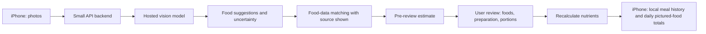

# Photo-based meal nutrition app: implementation plan

Status: accepted on 2026-10-22 after confirmation of the shared product understanding.

## Product contract

- An English-language iPhone app for adults using meal photos for general wellness.
- A meal entry may contain multiple photos of the same food from different angles and additional dishes. Each visible food is counted once across the photos.
- The app estimates calories, protein, carbohydrates, and fat for **all pictured food**, including food that was shared or left uneaten. Daily figures are labeled **pictured-food totals**, not personal intake.
- Results are approximate. The app flags uncertainty, asks for key ingredients or preparation details when needed, and lets the person correct foods and portions using serving units or grams. Saved entries remain editable.
- The app keeps photos and meal history on the iPhone. Photos may be uploaded for analysis; the chosen provider may retain submitted content for debugging or improvement, which the app must disclose.
- Broad cuisine coverage is a research goal. Public release waits for a diverse validation study against weighed meals and known recipes. The calibration pilot sets numeric pass criteria before the larger validation test.

## Technical shape

1. Build the iPhone interface in **SwiftUI**. Use **PhotosPicker** for multiple existing photos and **AVFoundation** for in-app camera capture. Store meal metadata with **SwiftData** and retain photo files locally. [Apple PhotosPicker](https://developer.apple.com/documentation/photosui/photospicker), [Apple camera capture](https://developer.apple.com/documentation/avfoundation/avcapturephotooutput), [Apple SwiftData](https://developer.apple.com/documentation/swiftdata).
2. Send selected photos through a small backend to a hosted vision API. Ask it for structured candidate foods, likely duplicates across photos, possible portion units, and specific unknowns. Its output is a suggestion, not the nutrient source. Keep the API key on the backend. [Google image understanding](https://ai.google.dev/gemini-api/docs/image-understanding), [structured outputs](https://ai.google.dev/gemini-api/docs/structured-output), [API-key guidance](https://docs.cloud.google.com/docs/authentication/api-keys-best-practices).
3. Match reviewed foods to documented nutrition sources. Normalize results to nutrients per 100 g, preserve each source ID and name, convert reviewed serving units to grams, and calculate totals in app code. Start with one documented dataset while designing an adapter for more regional sources. If a source needs an API key, call it from the backend; a downloaded dataset can be packaged locally. USDA FoodData Central supplies food nutrients and portion weights for its survey-food data, but its coverage reflects US dietary data. [USDA data documentation](https://fdc.nal.usda.gov/data-documentation/), [API guide](https://fdc.nal.usda.gov/api-guide/).
4. Add a custom-food path with user-entered nutrition when no suitable reference exists. For mixed dishes, prompt for high-impact missing details such as oils, sauces, or cooking method. Mark unresolved items as uncertain rather than treating an image-model guess as a fact.
5. Save the edited entry on the iPhone. Recalculate its daily pictured-food total whenever the entry changes. Measure pre-review estimates and final reviewed estimates separately.

## Free-first prototype

The Gemini API currently advertises a limited free tier with image understanding and structured output; verify the available model and live quota in the developer account before coding against it. Its unpaid-service terms permit Google to use submitted content and responses to improve products and may involve human review. Use non-sensitive test photos for the free prototype, disclose this data flow, and revisit the provider and tier before accepting public uploads. Free-tier quotas can change and are not a production capacity promise. [Gemini pricing](https://ai.google.dev/gemini-api/docs/pricing), [rate limits](https://ai.google.dev/gemini-api/docs/rate-limits), [additional terms](https://ai.google.dev/gemini-api/terms).

Keep the first backend local during development so no hosting purchase is needed. It can be deployed after the prototype proves the workflow. The nutrition-data layer can start with a free documented source, while international validation identifies which additional regional sources are required.

## Build sequence

1. **Manual vertical slice:** multi-photo meal entry, food search/custom food, portion editing, four nutrient totals, source display, local history, and daily pictured-food totals. This proves the data model and calculation without image-model noise.
2. **Photo suggestions:** hosted vision call through the backend, structured output, cross-photo duplicate review, uncertainty prompts, and correction flow.
3. **Calibration:** collect consented test meals from varied cuisines with weighed portions and known recipes. Compare pre-review and reviewed estimates with reference values; record calorie and macro errors, missing-food rate, and correction time. Set numeric launch criteria from this pilot.
4. **Validation and expansion:** test on new meals kept out of calibration, stratified by cuisine and dish type. Add regional nutrition sources where failures cluster. Release broadly only when the agreed criteria are met.

## Known limitation

No photo can establish every hidden ingredient or exact portion. Research on image-based dietary assessment identifies portion size, preparation method, and hidden ingredients as major error sources. The app's reliability must therefore come from explicit uncertainty, user correction, traceable food data, and validation—not a claim that the camera measures nutrients directly. [Dietary-assessment review](https://pmc.ncbi.nlm.nih.gov/articles/PMC7686022/), [multi-dataset study](https://pmc.ncbi.nlm.nih.gov/articles/PMC13306177/).
